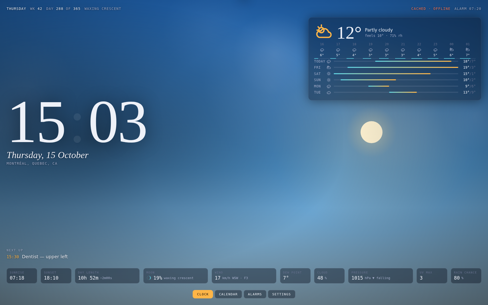

# Observatory Clock

A single-file desk clock for an Android tablet: time, weather, alarms and a calendar,
over an animated sky that tracks the real sun, moon and current conditions.

Built to replace an Amazon Echo Show on a desk. No account, no cloud, no microphone,
no camera. Everything you enter stays in the tablet's own browser storage.



---

## What it shows

**Clock view** — the time, the date, your next event, and an instrument row along the
bottom: sunrise, sunset, day length with the change since yesterday, moon phase and
illumination, wind with compass point and Beaufort number, dew point, cloud cover,
barometric pressure with its 3-hour trend, UV index and rain chance.

The background is a live canvas. Stars come out and twinkle after dark, with an aurora
on clear nights. The sun travels the real arc between today's sunrise and sunset; the
moon takes over at night, drawn at its true phase. Clouds drift, rain streaks, snow
falls, and thunderstorms flash — all driven by the current weather code.

**Calendar view** — month grid with your events, plus an agenda for the selected day
and what's coming up.

**Alarms view** — repeating or one-shot alarms with three chimes and a 9-minute snooze.

**Three themes** — Observatory (the full sky), Noir (graphite, no particles), and
Terminal (phosphor green, mono, scanlines).

---

## Getting it onto the tablet

The file is self-contained. Copy `index.html` to the tablet however you like — USB,
Drive, email it to yourself, `adb push`.

### Recommended: Fully Kiosk Browser

The free version does everything a wall dashboard needs and is the usual answer for
this on Android.

1. Install **Fully Kiosk Browser** from the Play Store.
2. Settings → **Web Content** → Start URL → `file:///sdcard/Download/index.html`
   (adjust to wherever you put it).
3. Settings → **Device Management** → turn on *Keep Screen On*.
4. Settings → **Kiosk Mode** → turn on *Start on Boot* if you want it to come back
   after a reboot.

### Without an extra app

Chrome on Android can be awkward about opening local files — it often downloads them
instead. Two ways around it:

- Host the file anywhere over HTTPS (GitHub Pages works), open it in Chrome, then
  **⋮ → Add to Home screen**. You get a fullscreen launcher icon, geolocation works,
  and *Keep screen awake* works.
- Or keep the screen on from Android itself: **Settings → About tablet** → tap *Build
  number* seven times → **Developer options** → *Stay awake while charging*.

### First run

Open **Settings** and search for your city. Everything else has a sensible default.

---

## Privacy

Two outbound requests, both optional:

| Request | What it sends | How to remove |
|---|---|---|
| [Open-Meteo](https://open-meteo.com) weather | Latitude and longitude, rounded to 2 decimals (~1 km) | Leave the location unset |
| Google Fonts | Your IP, on first load, then cached | Delete the single `<link rel="stylesheet" …fonts.googleapis.com…>` line |

The fallback font stack is chosen so the page still looks right with that line deleted.
The screenshots in `docs/` were taken with fonts blocked, so they show exactly what the
zero-Google build looks like.

Nothing else leaves the device. There is no analytics, no service worker, no account,
and no server. *Export my data* in Settings writes a JSON file; *Erase everything*
clears the single localStorage key.

---

## Calendar

Events you add in the app are stored locally and never sync.

**Importing from Google Calendar:** Google Calendar → Settings → pick your calendar →
*Export*. Unzip it and drop the `.ics` into **Settings → Import an .ics file**.
Re-import any time; an import replaces the previous import and leaves events you typed
yourself alone.

**Why there's no live Google sync:** Google serves the secret `.ics` address without an
`Access-Control-Allow-Origin` header, so a browser refuses to read it from a page. There
is no way around that without routing your private calendar URL through a third-party
proxy, which would defeat the point. The URL field works for any feed whose server does
send CORS headers — Nextcloud configured for it, or your own host.

---

## Known limits

- **Alarms are not a wake-up alarm.** They only fire while the page is open and the
  tablet is awake, and Android will throttle or kill a backgrounded tab without warning.
  Use the tablet's Clock app for anything you must not sleep through.
- Browsers block audio until you interact with the page, so there's a one-time
  *Enable sound* tap after a cold start.
- *Keep screen awake* uses the Screen Wake Lock API, which needs a secure context. It
  does nothing over `file://` — use Fully Kiosk's own setting there.
- Monthly repeats on the 29th–31st skip months that are too short.
- `.ics` import reads `DTSTART`, `SUMMARY` and the `FREQ` part of `RRULE`. Per-event
  timezones other than UTC are read as local wall-clock time; `BYDAY`, `COUNT` and
  `UNTIL` are ignored.
- *Pixel-shift the clock* exists for OLED panels. The Tab FE range is LCD, so leave it
  off.

---

## Development

No build step, no dependencies. Open `index.html` in a browser.

```sh
# logic tests — ISO weeks, day-of-year, moon phase, recurrence, .ics parsing
node test/logic.test.js
```

The moon phase is checked against published 2026 new and full moons and agrees to
within about 2% illumination.
